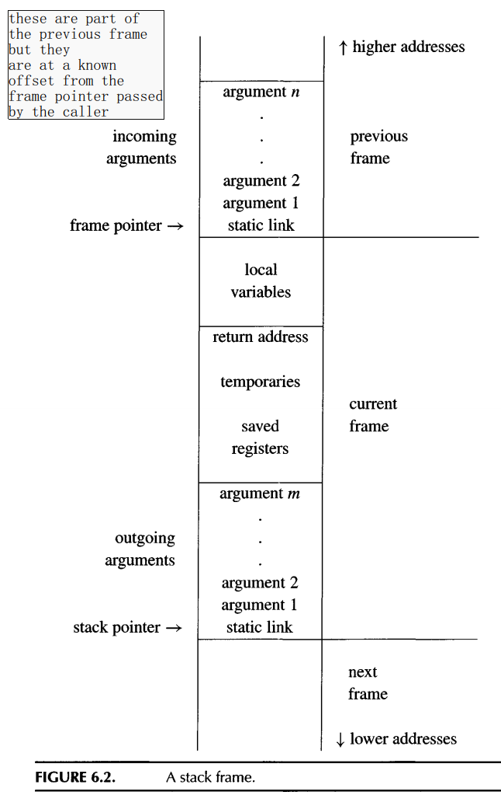
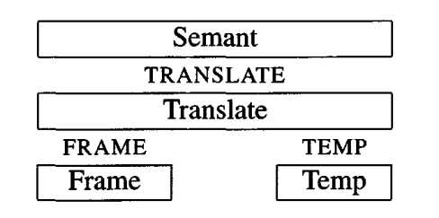

#+title: Activation Records
#+STARTUP: showall indent
#+STARTUP: hidestars
#+TOC: nil  ;; Disable table of contents by default
#+OPTIONS: toc:nil  ;; Disable TOC in HTML export

#+BEGIN_EXPORT html
---
layout: default
title: Activation Records
nav_exclude: true
---
#+END_EXPORT

Languages like C / Tiger have stackable local variables.
Local variables are created on function entry and
destroyed on function exit, then we can use a LIFO data structure - a stack -
to hold them.

For other languages like SML, which support high order functions, can not use stack way to hold local variables.

* stack frame

The stack usually grows only at the entry to a function, by an increment large enough to hold all the local variables for
that function, and, just before the exit from the function, shrinks by the same amount.

The area on the stack devoted to the local variables, parameters, return address, and other temporaries
for a function is called the function's activation record or stackframe.

The manufacturer of a computer often prescribes a "standard" frame layout to be used on that architecture.

The following is one example of stack frame calling convention:

CPU also have registers which can be used to hold variable when use current stack frame.

A modern procedure-call convention will pass function parameters in registers, pass the return address in a register, and return the function result in a
register. Many of the local variables will be allocated to registers, as will the
intermediate results of expression evaluation. Values are written to memory
(in the stack frame) only when necessary

** STATIC LINKS

Static link is used for lower level stack frame to access higher level stack frame.
This senorio happens when upper functions create a local variable and lower function uses it.

* Frames in Tiger

Here we face the fact that every target machine architecture will have a different standard stack
frame layout. If we want Tiger functions to be able to call C functions, we
should use the standard layout. But we don't want the specifics of any particular machine intruding on the implementation of the semantic analysis module of the Tiger compiler.

We must use abstraction.
** Two layer of abstractions

The FRAME and TEMP interfaces provide machine-independent views of memory-resident and register-resident variables.

* code

The [[https://github.com/SouthernPark/TigerCompiler/blob/main/intermediate_representation/main.sml][main.sml]] parse the source file to produce the abstract syntax tree, and then using findescape to check if there are var needs to escape.

The [[https://github.com/SouthernPark/TigerCompiler/blob/main/intermediate_representation/semant.sml][semant.sml]] will take abstract syntax tree and do translate, instead of return types, it will return traslated Intermediate Rerpesentation.

The [[https://github.com/SouthernPark/TigerCompiler/blob/main/intermediate_representation/mipsframe.sml][mipsframe.sml]] is used to record function call and frames needed for local variables. The frame abstrac 2 ways to store variables, one way is to store it
in frame if escape, ow store in register (asume we have unlimited registers).
