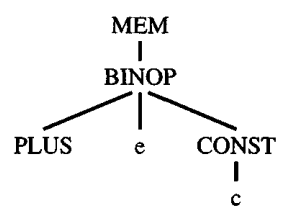

#+title: Instruction Selection
#+STARTUP: showall indent
#+STARTUP: hidestars
#+TOC: nil  ;; Disable table of contents by default
#+OPTIONS: toc:nil  ;; Disable TOC in HTML export

#+BEGIN_EXPORT html
---
layout: default
title: Instruction Selection
nav_exclude: true
---
#+END_EXPORT

The intermediate representation (Tree) language expresses only one operation in each tree node: memory fetch or store, addition or subtraction, conditional jump, and so on. A real machine instruction can often perform several
of these primitive operations. For example, almost any machine can perform
an add and a fetch in the same instruction, corresponding to the tree

Finding the appropriate machine instructions to implement a given intermediate representation tree is the job of the instruction selection phase of a compiler.

* Tiling the tree according to Tree pattern

We can express a machine instruction as a fragment of an IR tree, called a tree
pattern. Then instruction selection becomes the task of tiling the tree with a
minimal set of tree patterns.

The following is an example about how MIPS instruction is tiled in IR:
[[https://github.com/SouthernPark/TigerCompiler/tree/494d75775b80c3ed636ddc38eb15b413363be0e3/instruction_selection#readme][README]]
#+begin_src
+----------------+--------------+------------------------------+-------------+-----------+
| name           | effect       |trees                         | notes       |# of nodes |
+----------------+--------------+------------------------------+-------------+-----------+
| add $d, $s, $t | $d = $s + $t |  +                           |signed       | 1         |
|                |              | / \                          |arithmatics  |           |
|                |              |                              |             |           |
+----------------+--------------+------------------------------+-------------+-----------+
|sub $d, $s, $t  | $d = $s - $t |  -                           |signed       | 1         |
|                |              | / \                          |             |           |
|                |              |                              |             |           |
+----------------+--------------+------------------------------+-------------+-----------+
|mul $d, $s, $t  | $d = $s * $t |  *                           |low 32 bits  | 1         |
|                |              | / \                          |of the res is|           |
|                |              |                              |stored in $d |           |
|----------------+--------------+------------------------------+-------------+-----------|
|sw $t, i($s)    |MEM[$s+i] = $t|   MOVE   MOVE   MOVE    MOVE |store word (4| 4, 3, 2   |
|                |              |     |      |     |       |   |bytes)       |           |
|                |              |    / \    / \   / \     / \  |             |           |
|                |              |  MEM    MEM    MEM    MEM    |             |           |
|                |              |   |       |     |      |     |             |           |
|                |              |   +       +     i            |             |           |
|                |              |  / \     / \                 |             |           |
|                |              |  i         i                 |             |           |
+----------------+--------------+------------------------------+-------------+-----------+
#+end_src

** MAXIMAL MUNCH
The algorithm for optimal tiling is called Maximal Munch. It is quite simple.
Starting at the root of the tree, find the largest tile that fits. Cover the root
node - and perhaps several other nodes near the root - with this tile, leaving
several subtrees. Now repeat the same algorithm for each subtree.

The implementation for MAXIMAL MUNCH is in [[https://github.com/SouthernPark/TigerCompiler/blob/494d75775b80c3ed636ddc38eb15b413363be0e3/instruction_selection/mipsgen.sml][mipsgen.sml]]

It will help to produce the assembly code defined in [[https://github.com/SouthernPark/TigerCompiler/blob/main/instruction_selection/assem.sml][assem.sml]]

Note that, the current assembly code will still use abstract register (assume inifinite number registers).
In the following liveness analysis and register allocation, we will restrict the number of registers.
