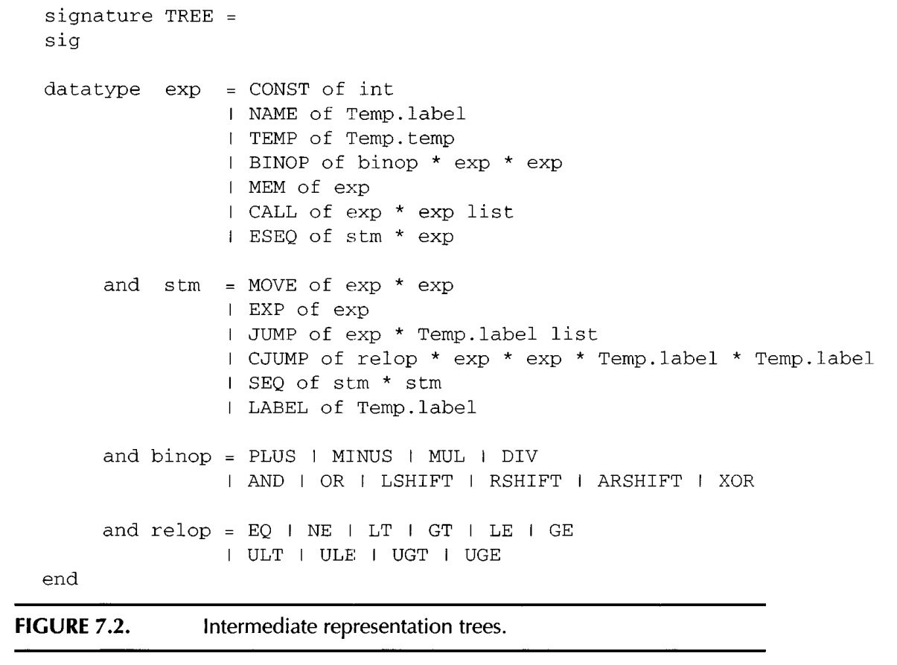
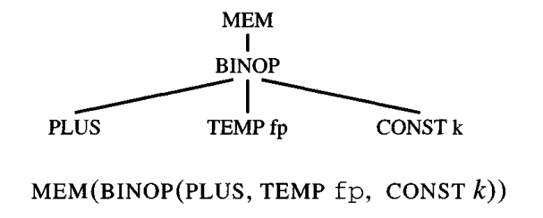

#+title: Intermediate Representation
#+STARTUP: showall indent
#+STARTUP: hidestars
#+TOC: nil  ;; Disable table of contents by default
#+OPTIONS: toc:nil  ;; Disable TOC in HTML export

#+BEGIN_EXPORT html
---
layout: default
title: Intermediate Representation
nav_exclude: true
---
#+END_EXPORT

An intermediate representation (IR) is a kind of abstract machine language
that can express the target-machine operations without committing to too
much machine-specific detail.

It is also independent of the details of the source language.

The [[https://github.com/SouthernPark/TigerCompiler/blob/main/intermediate_representation/tree.sml][tree.sml]] defines the node type for IR representation, which is similar to instruction selection set.

The intermediate representation (Tree) language expresses only one abstract operation in each tree node: memory fetch or store, addition or subtraction, conditional jump, and so on.

* IR tree
Example:

* Translation Expression into Trees
Translation of abstract syntax expressions into intermediate trees is reasonably straightforward; but there are many cases to handle.

** kinds of exression
1. Expression that returns a value
2. Expression that returns no value (while expression, procedure call)
3. Conditional expression (if .. else)

** Simple Variable
For a simple variable v declared in the current procedure's stack frame, we translate it as

** TODO Static Link

** Array variable
Array may need external call to allocall like malloc to allocate size and move the return value to a variable or register.

** Conditionals
can be created with SEQ and JUMP

** strings
add new lael to the string, and put into a global list, so that later we can put it into global section.

** TODO funciton call

* Declarations

The call to transDec will not only return a result record (containing a
new type environment, value environment, and Trans l a t e , exp) but also
will have side effects: for each variable declaration within the declaration,
additional space will be reserved in the current level's frame. Also, for each
function declaration, a new "fragment" of Tree code will be kept for the
function's body

** variable definition
transDec must also return an exp l i s t of assignment expressions that accomplish these
initializations.

** function definition

Each Tiger function is translated into a segment of assembly language with a prologue, a body, and an epilogue. The body of a Tiger function is an expression, and the body of the translation is simply the translation of that expression.

prolog and epilogue are used to handle stack pointer to allocate frame and exit from new frame.

Fucntion body is what really do by the function.
