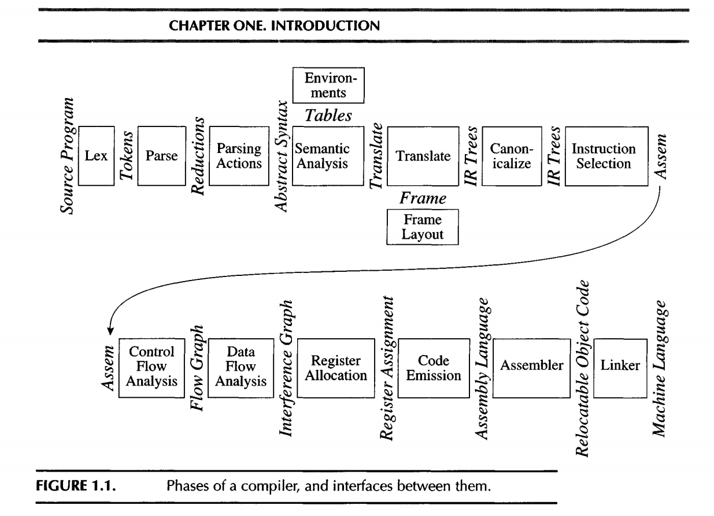
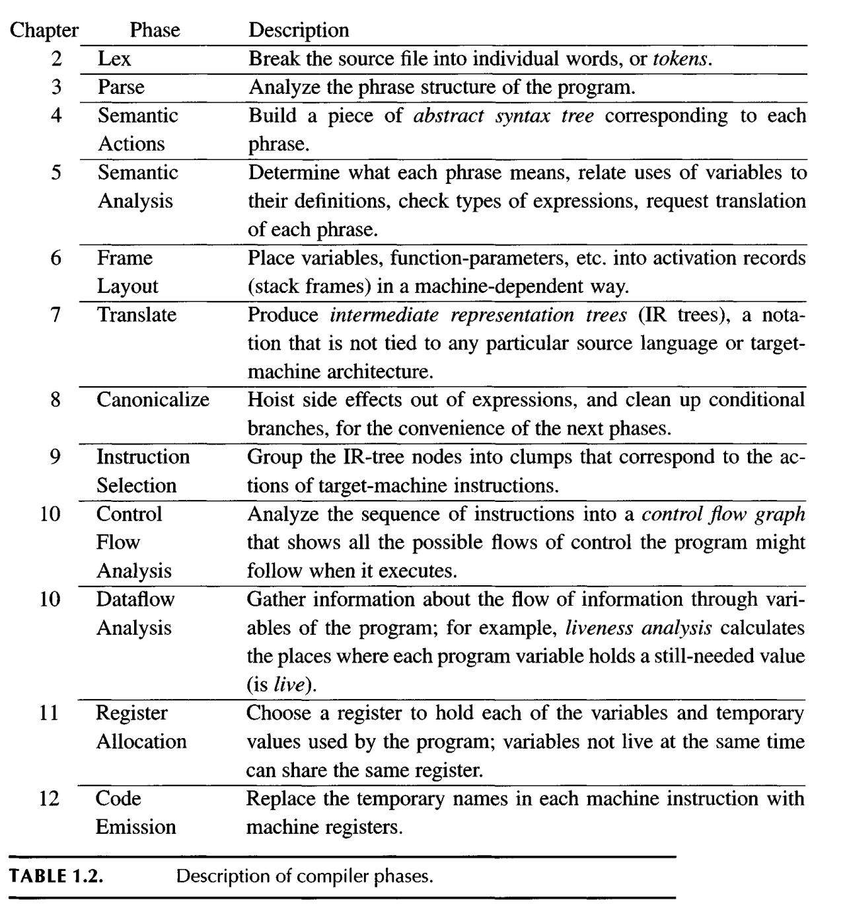
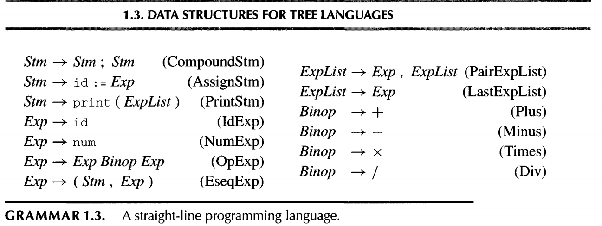
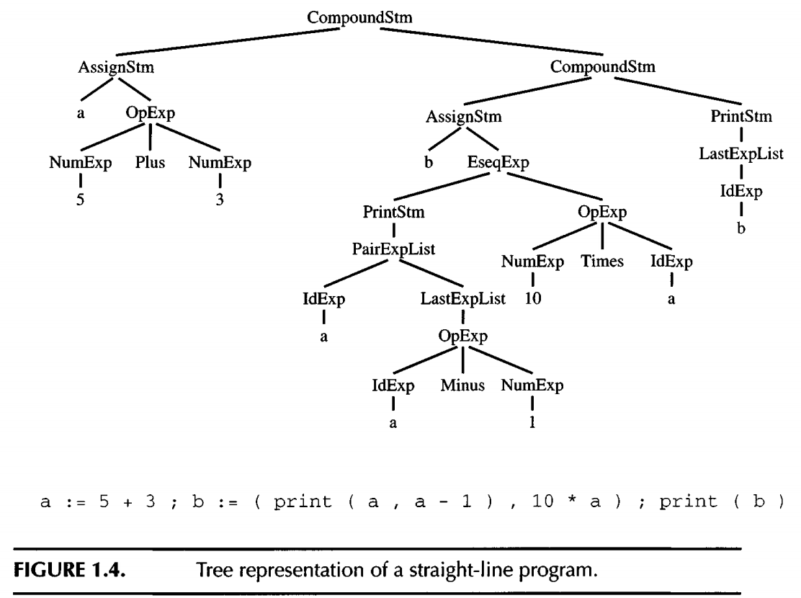
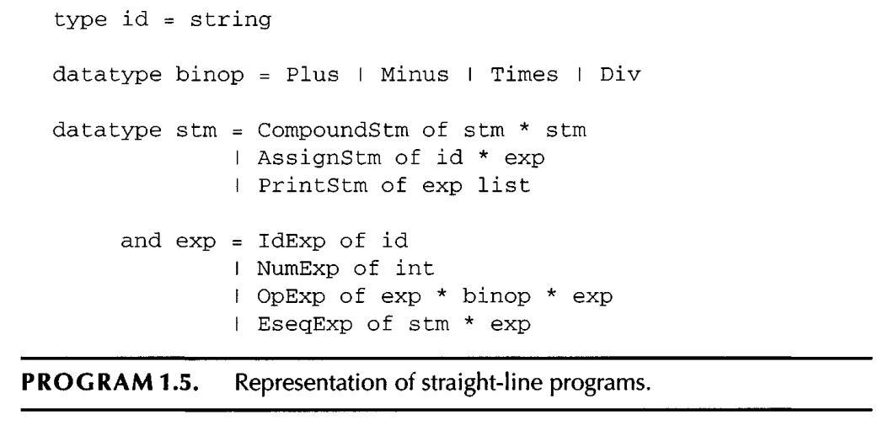

#+title: Intro

* Phases of Compiler

Breaking the compiler into this many pieces allows for reuse of the components.

Change target CPU?: Just replace the Frame Layout and Instruction Selection modules.

The front-end of the compiler (Lexer, Parser, Translate) handles source language syntax and parsing, transforming it into a language-independent AST.
After Translate, the rest of the compiler (IR, optimization, backend) does not care about the original source language syntax and works on the AST and IR.

** data structure (Tree) for programming language representation

