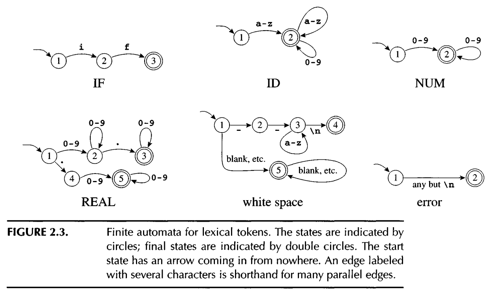
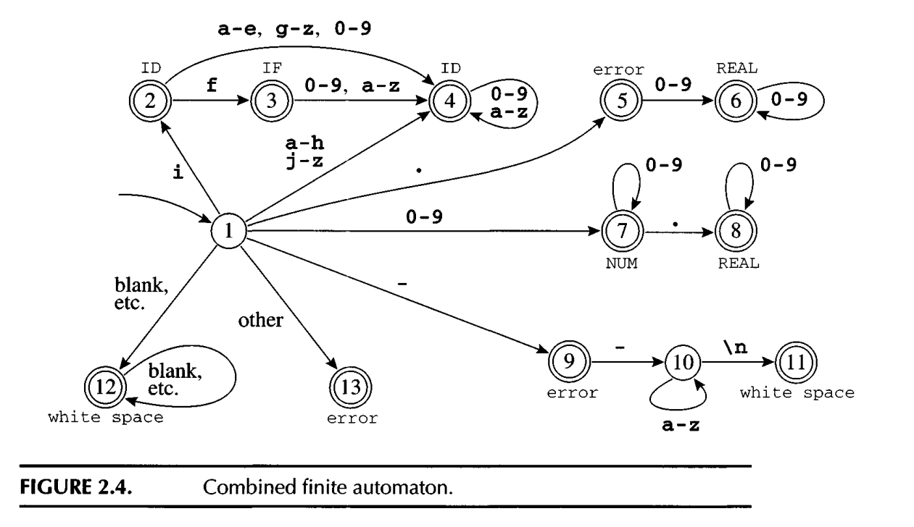
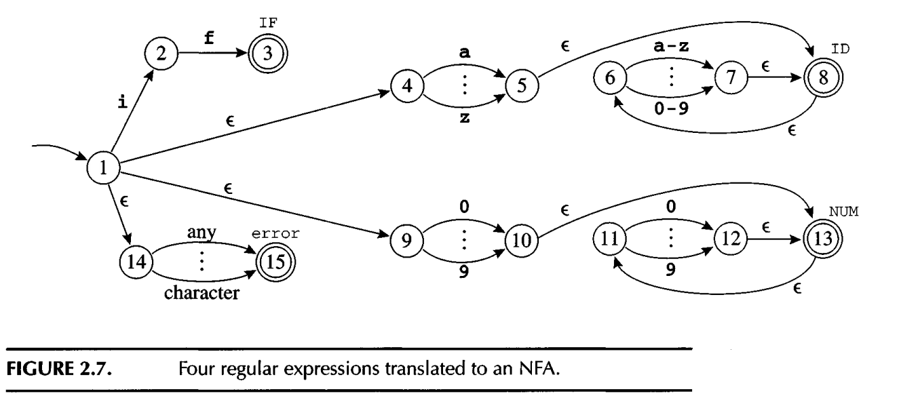
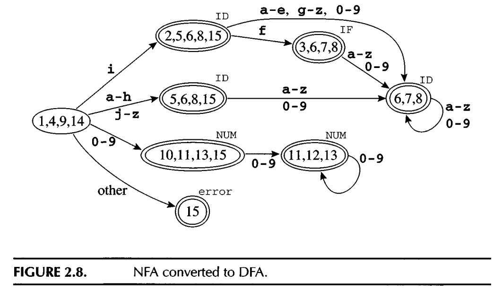

#+title: Lexical Analysis
#+STARTUP: showall indent
#+STARTUP: hidestars
#+TOC: nil  ;; Disable table of contents by default
#+OPTIONS: toc:nil  ;; Disable TOC in HTML export

#+BEGIN_EXPORT html
---
layout: default
title: Lexical Analysis
nav_exclude: true
---
#+END_EXPORT

* Lexical Analysis
The front end of the compiler performs analysis; the back end does synthesis.

Lexical analysis: breaking the input into individual words or "tokens";
Syntax analysis: parsing the phrase structure of the program; and
Semantic analysis: calculating the program's meaning.

Lexer uses regular expression and 2 basic rules (longest match, rule priority) to
match tokens from the output.

Regular expression is good for simple notion, but not easy for computer program to
implement it.

It's easier for computer program to use Deterministic Finite Automata (DFA) to implement
the explict state transactions from one state to another state and emission tokens.

But it's hard for human to write DFA when rules are complicated.
NFA (Non -deterministic Finite Automata) is much easier for human to rule out.

It turns out regular expression, DFA and NFA can be transformed to each other.

** Lexical Tokens
A lexical token is a sequence of characters that can be treated as a unit in the grammar of a programming language.
Example:
#+begin_src
Type Examples
ID        foo nl4 last
NUM       73 0 00 515 082
REAL      6 6 . 1 . 5 1 0 . I e 6 7 5 . 5 e - 1 0
IF        if
COMMA     ,
NOTEQ     !=
LPAREN    (
RPAREN    )
#+end_src

Some strings are reserved keywords like return, if, void, they are not treated as ID, but as a type directly.

soruce code to tokens example
#+begin_src c
float matchO(char *s) /* find a zero */
{if (!strncmp(s, "0.0", 3))
    return 0.;
}

FLOAT ID(matchO) LPAREN CHAR STAR ID(s) RPAREN LBRACE
IF LPAREN BANG ID(strncmp) LPAREN ID(s)
COMMA STRING(O.O) COMMA NUM(3) RPAREN RPAREN
RETURN REAL(O.O) SEMI RBRACE EOF
#+end_src

*** preprocessor directive
#+begin_src
preprocessor directive #include<stdio. h>
preprocessor directive # define NUMS 5 , 6
#+end_src

the preprocessor operates on the source character stream, producing another character stream that is then fed to the lexical analyzer.

** regular expression
Regular expression is used to match tokens.

The following is some regexp notations
#+begin_src
if                                   (IF);
[a-z][a-zO-9]*                       (ID);
[0-9]+                               (NUM);
([0-9]+"."[0-9]*)|([0-9]*"."[0-9]+)  (REAL) ;
("--"[a-z]*"\n")I(" "I"\n"I"\t")+    (continue());
.                                    (error();continue() )
#+end_src

Two rules usually used in regular expression when multi regexp can be used on the string:
#+begin_src
Longest match: The longest initial substring of the input that can match any
regular expression is taken as the next token.
Some the regexp always match as longer as possible.

Rule priority: For a particular longest initial substring, thefirstregular expression
that can match determines its token type. This means that the order of writing down
the regular-expression rules has significance
One token can be matched by multi regexp rule, use the first rule defined.

#+end_src

if8 is matched as an ID(if8) using the longest match, ranther than matched as IF and ID(8)
if is matched as IF because of rule priority, rather then ID(IF)

** Finite Automata
Regular expression is a good for notion, but we not good for program.
Finite automata can be used by program to specify how many states, which state is acceptale
and how to transform from one state to another state.
The following diagram list 6 seperate finite automata for the above 6 regexp

Need someway to hoc them up into one finite automata

*** DFA (Deterministic Finite Automata)
A Deterministic Finite Automaton (DFA) is a theoretical finite-state machine used in formal language theory to recognize regular languages.

For each state and input symbol, there is exactly one possible next state.
(Contrast with NFA, where multiple or zero transitions may exist for a state and input.)

The following diagram is a combined finite automata by the 6 seperate finite automata

We can have a 2D matrix : m[state1][symbol1] = state2, which represets state1 will transit to state2 after reading
symbol1.

**** recognize the longest match
The lexer needs to identify the longest match. The lexer uses 2 pointer approach to track the pointer to last-final and input-position-at-last-final.

When it hits a final state, the pointers will be updated. When a dead state is hit, the pointers tell what tokens
are matched and where it ends.

*** NFA (Non-deterministic Finite Automata)
Derministic is easy for program to implement it, but hard for human to write it out.
NFA is easier for human to write it out when rules are complicated.

From a given state and a input symbol, the NFA may: Move to multiple next states; Move to no state (no transition);
Move without consuming any input (ε-transitions / epsilon moves).

The following shows how NFA is simply used to include 4 regexp into one automata:

**** converting an NFA to DFA
It's hard for computer program to implement NFA. Need to translate it to DFA.

The key to translate from NFA to DFA is to find the e-closure (epsilon: empty which can help to translate
from one state to another state without consume chars).

The e-closure for one state will be a set of states that can be reached from that state through e.

For each state, we find its e-closure and the transitions between different closures.

The following is an example traslate the above NFA to DFA:

** ML-Lex
ML-Lex is a lexical analyzer generator which helps to translate and combine regexp to DFA.

For each token type in the programming language to be lexically analyzed, the specification contains a regular expression and an action.
The action communicates the token type (perhaps along with other information) to the next phase of the compiler.

The output of ML-Lex is a program in ML - a lexical analyzer that interprets a DFA using the algorithm described in Section 2.3 and executes the
action fragments on each match.

The following is part of snap code in [[https://github.com/SouthernPark/TigerCompiler/blob/main/lexical_analysis/tiger.lex][tiger.lex]] using ML-Lex
#+begin_src sml
type pos = int
type lexresult = Tokens.token
...

%%
digit = [0-9];
id = [a-zA-Z][a-zA-Z0-9_]*;
ws = [\t\ \n\r];
%%

...
<INITIAL>type		=> (Tokens.TYPE(yypos, yypos + 4));
<INITIAL>var		=> (Tokens.VAR(yypos, yypos + 3));

<INITIAL>{digit}+	=> (Tokens.INT(valOf(Int.fromString yytext), yypos, yypos + size yytext));
<INITIAL>{ws}		=> (continue());
<INITIAL>{id} 		=> (Tokens.ID(yytext, yypos, yypos + size(yytext)));
#+end_src

[[https://github.com/SouthernPark/TigerCompiler/blob/main/lexical_analysis/tokens.sig][tokens.sig]] defines the interface for Tokens and functions which takes parameters and return tokens.
In tokens.sig we manually define the token signature, which is good for learning the lexer mechanics without depending on the parser yet.

In the next chapter Parser, the ML-Yacc generates its own Token Structure. So before run the ML-Tacc,
you will not see the Token structures.
