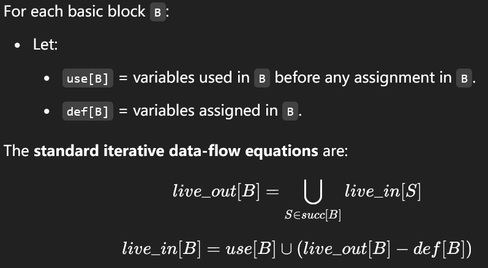
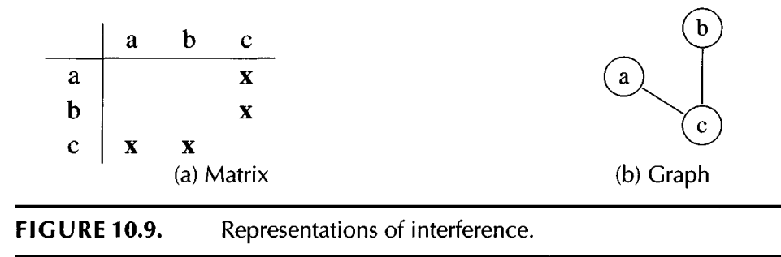

#+title: Liveness Analysis

#+STARTUP: showall indent
#+STARTUP: hidestars
#+TOC: nil  ;; Disable table of contents by default
#+OPTIONS: toc:nil  ;; Disable TOC in HTML export

#+BEGIN_EXPORT html
---
layout: default
title: Liveness Analysis
nav_exclude: true
---
#+END_EXPORT

The front end of the compiler translates programs into an intermediate language with an unbounded number of temporaries. This program must run on a machine with a bounded number of registers. Two temporaries a and b
can fit into the same register, if a and b are never "in use" at the same time.
Thus, many temporaries can fit in few registers; if they don't all fit, the excess
temporaries can be kept in memory.

Therefore, the compiler needs to analyze the intermediate-representation
program to determine which temporaries are in use at the same time. We say
a variable is live if it holds a value that may be needed in the future, so this
analysis is called liveness analysis.

* Liveness

Live-in: A variable v is live-in at a program point p if v is used (not defined) at current point or later point.

A variable v is live-out at a program point p if is live in the later point of v

* Interference
One of the most important applications of liveness analysis is for register
allocation: we have a set of temporaries a,b,c,... that must be allocated to
registers r1,..., rk. A condition that prevents a and b being allocated to the
same register is called an interference

The most common kind of interference is caused by overlapping live ranges:
when a and b are both live at the same program point, then they cannot be
put in the same register.

If a and b has inference, we can add an edge between them to mark, they can not appear at the same time.
The following is an example:

* Liveness in Tiger

After the instruction selection, we get a list of assembly code with inifinite registers.

The flow analysis for the Tiger compiler is done in two stages:
first, the control flow of the Ass em program is analyzed, producing a control-flow graph;
then, the liveness of variables in the control-flow graph is analyzed, producing
an interference graph

Each instruction (or basic block) is represented by a node in the flow graph. If instruction m can be
followed by instruction n (either by a jump or by falling through), then there
will be an edge (m, n) in the graph.

The [[https://github.com/SouthernPark/TigerCompiler/blob/main/liveness_regalloc/makegraph.sml][makegraph.sml]] defines how the flow graph is made according to the assembly.
The graph will also note the reg used in current node and the defined in current node to help build the
interference graph.

[[https://github.com/SouthernPark/TigerCompiler/blob/494d75775b80c3ed636ddc38eb15b413363be0e3/liveness_regalloc/liveness.sml][liveness.sml]] takes a flowgraph and return an IGraph and a table mapping each flowgraph node to the
liveout set of temps. (the interference reg are those in the live-out set)
