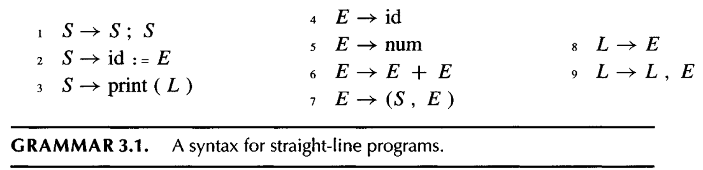
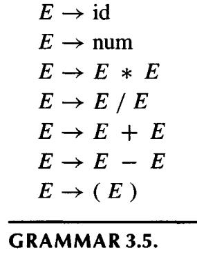
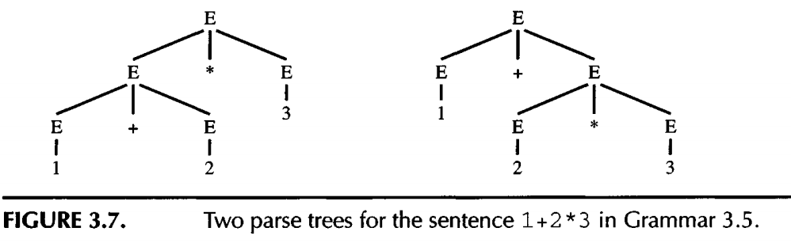
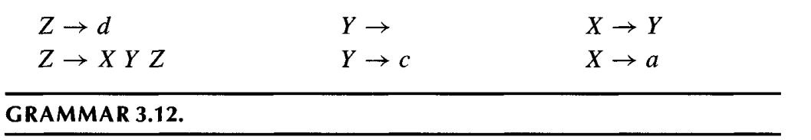
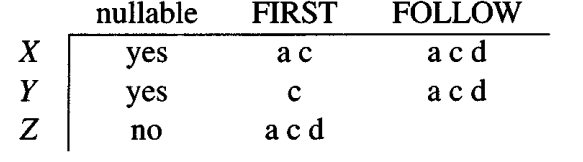
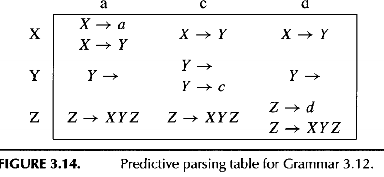

#+title: Parsing
#+STARTUP: showall indent
#+STARTUP: hidestars
#+TOC: nil  ;; Disable table of contents by default
#+OPTIONS: toc:nil  ;; Disable TOC in HTML export

#+BEGIN_EXPORT html
---
layout: default
title: Parsing
nav_exclude: true
---
#+END_EXPORT

As before, we say that a language is a set of strings; each string is a finite
sequence of symbols taken from a finite alphabet.

Just as regular expressions can be used to define lexical structure in a static,
declarative way, grammars define syntactic structure declaratively.

* Context Free Grammar

A context-free grammar describes a language. A grammar has a set of productions of the form:
#+begin_src
symbol -> symbol symbol . . . symbol
#+end_src
where there are zero or more symbols on the right-hand side. Each symbol
is either terminal, meaning that it is a token from the alphabet of strings in the language, or nonterminal, meaning that it appears on the left-hand side of some production.

No token can ever appear on the left-hand side of a production.

Finally, one of the nonterminals is distinguished as the start symbol of
the grammar.

The following is a grammar for straignt-line program

** Ambiguous gramma
A grammar is ambiguous if it can derive a sentence with two different parse trees.
The following is a ambiguous gramma that can lead to two different parsing tree for the same sentence.

Ambiguous grammars are problematic for compiling: in general we would prefer to have unambiguous grammars. Fortunately, we can often transform ambiguous grammars to unambiguous grammars.

* Predictive Parsing

For the following programmer, we can use the terminals to classify which grammar to use.
We call these kind of grammars predictive, it is easier for to write program.
#+begin_src
S -> IF E TEHN S
S -> BEGIN S L
S -> PRINT E
#+end_src

But for the following grammars, there is a conflict here: the E function has no way to know which clause to
use.
#+begin_src
S -> E $
E -> E + T
E -> E - T
E -> T
#+end_src

Recursive-descent, or predictive, parsing works only on grammars where the first terminal symbol of each subexpression provides enough information to choose which production to use.

To understand this better, we will formalize the notion of FIRST sets, and then derive conflict-free recursive-descent
parsers using a simple algorithm.

** FIRST AND FOLLOW SETS

#+begin_src
nullable(X) is true if X can derive the empty string.
FIRST(R) is the set of terminals that can begin strings derived from y.
FOLLOW(Z) is the set of terminals that can immediately follow X. That is,
#+end_src

We can run some iteration algorithm to compute the first and following set for the above grammars:

The following is the table of grammar we constructed with using the first and follow set table and following rules:
#+begin_src
To construct this table, enter production X -> R in row X, column T of the table for each T belongs to FIRST(R).
Also, if y is nullable, enter the production in row X, column T for each T belongs FOLLOW[X].
#+end_src

But some of the entries like matrix[X][a], matrix[Y][c], matrix[Z][d] contain more than one production!
The presence of duplicate entries means that predictive parsing will not work on Grammar 3.12.

*** LL(1) parsing
Grammars whose predictive parsing tables contain no duplicate entries are called LL(1).
This stands for Left-to-right parse, Leftmost-derivation, 1-symbol lookahead

We can generalize the notion of FIRST sets to describe the first k tokens of
a string, and to make an LL(&) parsing table whose rows are the nonterminals
and columns are every sequence of k terminals. This is rarely done (because
the tables are so large)

* LR Parsing

The weakness of LL(k) parsing techniques is that they must predict which
production to use, having seen only the first k ~tokens~ of the right-hand side

A more powerful technique, LR(k) parsing, is able to postpone the decision
until it has seen input tokens corresponding to the entire right-hand side of
the production in question (and k more input tokens beyond).

LR(k) stands for Left-to-right parse, Rightmost-derivation, k-token lookahead.
The use of a rightmost derivation seems odd; how is that compatible with a left-to-right parse?

The parser has a stack and an input. The first k tokens of the input are the
lookahead. Based on the contents of the stack and the lookahead, the parser
performs two kinds of actions:

Shift: move the first input token to the top of the stack.
Reduce: Choose a grammar rule X -> A B C; pop C, B, A from the top of the stack; push X onto the stack.

* Yacc (Parser Generator)

Parsing Grammar Rules user defined to generate LR parser.
