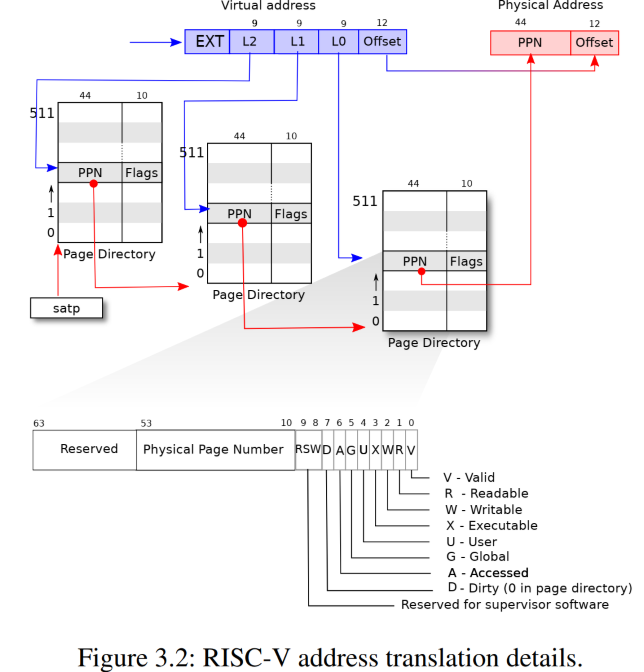
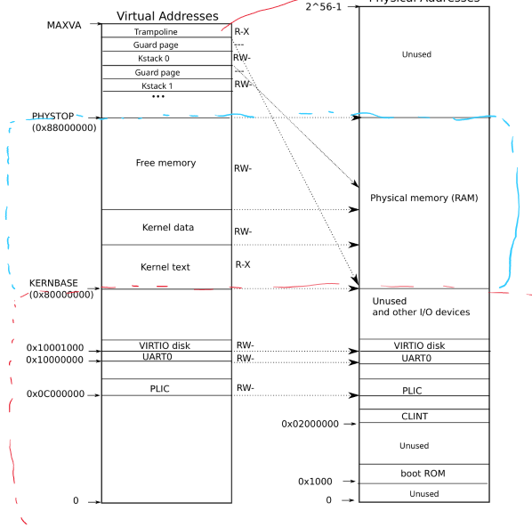
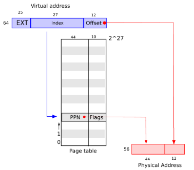
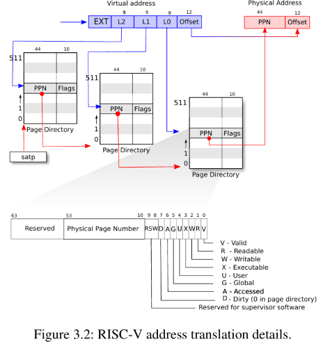
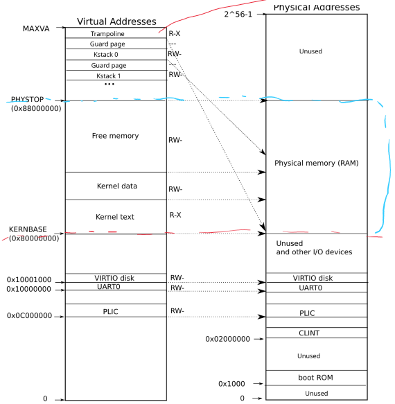
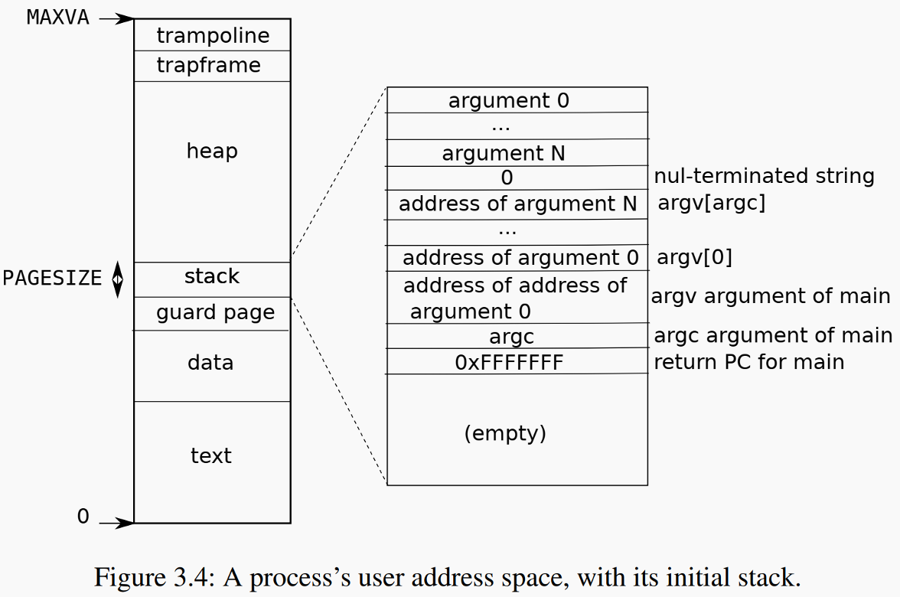
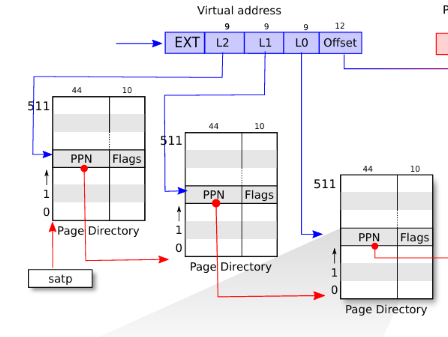

#+title: Page Table
#+STARTUP: showall indent
#+STARTUP: hidestars
#+TOC: nil  ;; Disable table of contents by default
#+OPTIONS: toc:nil  ;; Disable TOC in HTML export

#+BEGIN_EXPORT html
---
layout: default
title: Page Table
nav_exclude: true
---
#+END_EXPORT

* Intro
xv6 3 level page table and the walking process from VA to PA is showing below:

Virtual adress (VA) to Physical address (PA) translation can happen both in hardware and software
** hardware translation
In RISC-V, the hardware responsible for paging address translation is the Memory Management Unit (MMU), which includes:
1. Page Table Walker (PTW)
   walks the page table in memory when a TLB miss occurs
2. Translation Lookaside Buffer (TLB)
   A small, fast cache that stores recent virtual-to-physical address mappings.
3. SATP Register
   for the MMU to locate the root page table.

When is hardware
User or kernel code accesses memory through a virtual address (load/store/fetch)
The addresses in the user-space assembly code mostly uses the translation hardware like MMU to do VA to PA
atomatically, without the help of software translation.

User programs always use Virtual Addresses (VA).
All translations (for loads, stores, jumps) are done automatically by hardware (MMU + TLB + PTW).
The user code never needs to know about physical addresses.

** software translation

Kernel address space is different from user address space

In xv6 kernel address space is mapped directly to Physical Address space, the RAM.

The kernel [[https://github.com/mit-pdos/xv6-riscv/blob/de247db5e6384b138f270e0a7c745989b5a9c23b/kernel/vm.c#L109][walkaddr]] fucntion in vm.c also provide a software simulation to get PA from VA.
In xv6 , Each process or even the kernel has a pagetable. The process in the kernel has its own page table.

The kernel uses software translation for situations where it:
    Needs to inspect or access user memory safely.
    Needs to build or update page tables.
    Needs to verify that a user pointer is valid and mapped.

* some calculation
Xv6 runs on RSIC-V 39 bits (Sv-39), the bottom 39 bits of the 64 bits virtual address are used.
Also givne that memo is byte addressable, so we can have 2 ^ 39 bytes = 512 MB virtual address space.

In xv6-riscv (which uses the Sv39 virtual memory scheme), the physical address size is 56 bits,
but xv6 typically uses only 32 or 36 bits of it depending on the hardware simulation.
Note that physical address space incldues: RAM and IO
The following disgram shows the kernel virtual address space and physical address space:

One page is usually 4KB = 2 ^ 12 bytes, so there will be 2 ^ (39 - 12) = 2 ^ 27 pages.
Each page needs one Page Table Entry. So we needs 2 ^ 27 PTEs
The first 44 bits in PTE will be PPN (Physical Page Number), the last 12 bits will be offset to a byte in that page.
Note that the physical address is 56 bits.
The following shows how VA is translated into PA from PTE:

We can either hold the 2 ^ 27 PTEs in one table, or multi-level page table.
** One page table
Even if the physical address us 56 bits, each PTE is 64bits = 2 ^ 3 bytes.
So to hold 2 ^ 27 PTEs in one table , the table size has to be 2 ^ (27 + 3) = 2 ^ 30 bytes = 1 GB
** Multi level page table
xv6 uses 3 level page table: the 2 ^ 27 bits for PTE is split equally into 3 ports, each with 9 bits.
As shown in the following:

There will be:
1 root level page table with 2 ^ 9 = 512 PTEs
2 ^ 9 second level page tables, each with 2 ^ 9 PTEs
2 ^ 18 third level page tables, each with 2 ^ 9 PTEs

Total 1 + 2 ^ 9 + 2 ^ 18 page tables, each with 2 ^ 9 PTEs
Each page table size will be 2 ^ 9 * 8 bytes = 2 ^ 12 bytes

(1 + 2 ^ 9 + 2 ^ 18) * 2 * 12 ~> 1 GB
** why mutil level page table
1. One page table requires 1GB continuous to be allocated at once for each process
2. Multi level keeps each page table as 4MB and can be allocated when needed discontiously
3. For processes need small memo, just need one root, one second level and one leaf level page table

Downside: MMU walks 3 times to the real PTE

TLB is used to store those PTEs that are recently used.

* Kerbel Address Space
kernel address space is mapped Physical Address space directly. The following diagram shows the mapping:

kernel maintains its own page tables

* User Address Space
The following shows the address space for user space process:

#+begin_src
test segment: used to store code
data segment: used to store intialuzed global variable / static variable
There is also an rodata segment not showing in the above graph
BSS: unitialized global / static variable
heap: for dynamic allocated memo
stack: in xv6 stage size 1 page by default
#+end_src

Something to note from the layout of vx6 user address space:
1. stack is fixed size, does not grow
2. The heap (at the high position) starts just after the loaded program segments and grows upward.
3. so looks like heap is the only one in user process that will ask kernel to dynamically allocate memo

So the heap top is tracked using proc->sz (size of process memory).
#+begin_src c
struct proc {
  ...
  uint64 sz;  // Size of process memory (bytes)
};
#+end_src
This sz value reflects the end of the heap. It is updated by functions like uvmalloc() and growproc()

In modern OS, stack memory is pre-allocated, and the kernel only gets involved if the stack grows
beyond its current allocation, which usually triggers a page fault.
This is some kind of page fault driven memo allocation.

Refer the following code section for how the heap memo allocation sbrk is implemented

* Code

** basic
There are some basic funcitons when halding page table.
Like walk through the page table to get the leaf PTE, extract the PPN from PTE,
and combine leaf PPN and VA to get PA.

*** [[https://github.com/mit-pdos/xv6-riscv/blob/2a39c5af63906b3dbd0db58b9f6846ad70f4315d/kernel/riscv.h#L367][PTE2PA PA2PTE]]

The following shows the layout of PTE and physical address layout for page that aligned well
#+begin_src
| PPN | flag 10 bits |

| PPN | offset 12 bits|
#+end_src

That's why the following code shift 12 bits or 10 bits to get PA -> PTE or PTE -> PA
#+begin_src c
// shift a physical address to the right place for a PTE.
#define PA2PTE(pa) ((((uint64)pa) >> 12) << 10)
#define PTE2PA(pte) (((pte) >> 10) << 12)
#+end_src

*** [[https://github.com/mit-pdos/xv6-riscv/blob/riscv/kernel/vm.c#L86][walk]]
Return the address of the PTE in page table pagetable
that corresponds to virtual address va.

Page tables may not be created ahead, Create any required page-table pages.
If alloc!=0, create any required page-table pages.

The following code implements the actions in the following diagram:

The for iteration loop twice to get the address of leaf level page table.
return uses the L0 index to get the leaf PTE address.
#+begin_src c
pte_t *
walk(pagetable_t pagetable, uint64 va, int alloc)
{
  if(va >= MAXVA)
    panic("walk");

  for(int level = 2; level > 0; level--) {
    pte_t *pte = &pagetable[PX(level, va)];
    if(*pte & PTE_V) {
      pagetable = (pagetable_t)PTE2PA(*pte);
    } else {
      if(!alloc || (pagetable = (pde_t*)kalloc()) == 0)
        return 0;
      memset(pagetable, 0, PGSIZE);
      *pte = PA2PTE(pagetable) | PTE_V;
    }
  }
  return &pagetable[PX(0, va)];
}
#+end_src

In xv6 (and RISC-V in general), the PTE_V bit (bit 0) in a page table entry (PTE)
tells you whether the PTE is valid, i.e., whether it maps something — either:
    1. A leaf mapping (points to a physical page), or
    2. A pointer to the next level of the page table (for multi-level walks)

Another to note is:
xv6 does not provide a machanizm to mechanizm to delete page tables,
when all the PTEs are invalid. Once a page table is created, it will remain there
no matter what.
But xv6 does provide a way to free page tables memo, when the process exit.

** sbrk heap grow/shrink

*** [[https://github.com/mit-pdos/xv6-riscv/blob/riscv/kernel/vm.c#L233][uvmalloc]]
Allocate PTEs and physical memory to grow process from oldsz to
newsz, which need not be page aligned.  Returns new size or 0 on error.

return the size of current virtual address space
#+begin_src c
uint64
uvmalloc(pagetable_t pagetable, uint64 oldsz, uint64 newsz, int xperm)
{
  char *mem;
  uint64 a;

  if(newsz < oldsz)
    return oldsz;

  oldsz = PGROUNDUP(oldsz);
  for(a = oldsz; a < newsz; a += PGSIZE){
    mem = kalloc();
    if(mem == 0){
      uvmdealloc(pagetable, a, oldsz);
      return 0;
    }
    memset(mem, 0, PGSIZE);
    if(mappages(pagetable, a, PGSIZE, (uint64)mem, PTE_R|PTE_U|xperm) != 0){
      kfree(mem);
      uvmdealloc(pagetable, a, oldsz);
      return 0;
    }
  }
  return newsz;
}
#+end_src

*** [[https://github.com/mit-pdos/xv6-riscv/blob/riscv/kernel/vm.c#L263][uvmdealloc]]
Deallocate user pages to bring the process size from oldsz to oldsz and newsz need not be page-aligned,
nor does newsz eed to be less than oldsz.  oldsz can be larger than the actual
process size.  Returns the new process size.

#+begin_src c
uint64
uvmdealloc(pagetable_t pagetable, uint64 oldsz, uint64 newsz)
{
  if(newsz >= oldsz)
    return oldsz;

  if(PGROUNDUP(newsz) < PGROUNDUP(oldsz)){
    int npages = (PGROUNDUP(oldsz) - PGROUNDUP(newsz)) / PGSIZE;
    uvmunmap(pagetable, PGROUNDUP(newsz), npages, 1);
  }

  return newsz;
}
#+end_src

*** [[https://github.com/mit-pdos/xv6-riscv/blob/de247db5e6384b138f270e0a7c745989b5a9c23b/kernel/sysproc.c#L39][sys_sbrk]]

sbrk uses uvmalloc and uvmdealloc to increase or decrease vm space
#+begin_src c
uint64
sys_sbrk(void)
{
  uint64 addr;
  int n;

  argint(0, &n);
  addr = myproc()->sz;
  if(growproc(n) < 0)
    return -1;
  return addr;
}
#+end_src

#+begin_src c
int
growproc(int n)
{
  uint64 sz;
  struct proc *p = myproc();

  sz = p->sz;
  if(n > 0){
    if((sz = uvmalloc(p->pagetable, sz, sz + n, PTE_W)) == 0) {
      return -1;
    }
  } else if(n < 0){
    sz = uvmdealloc(p->pagetable, sz, sz + n);
  }
  p->sz = sz;
  return 0;
}
#+end_src
